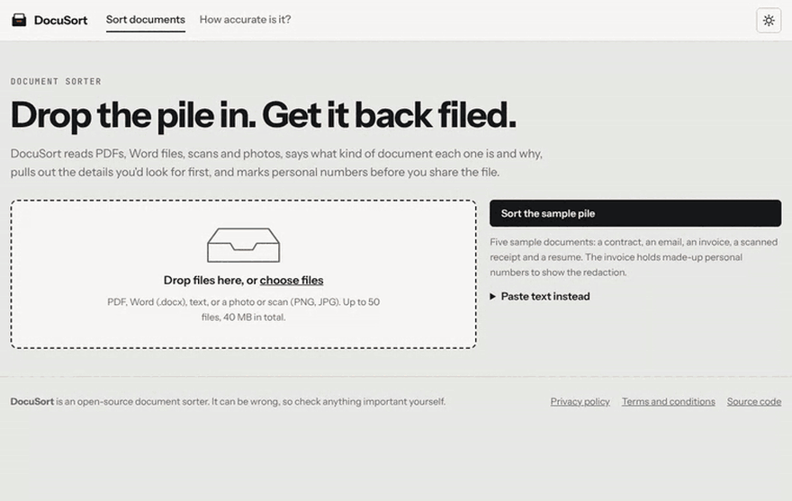
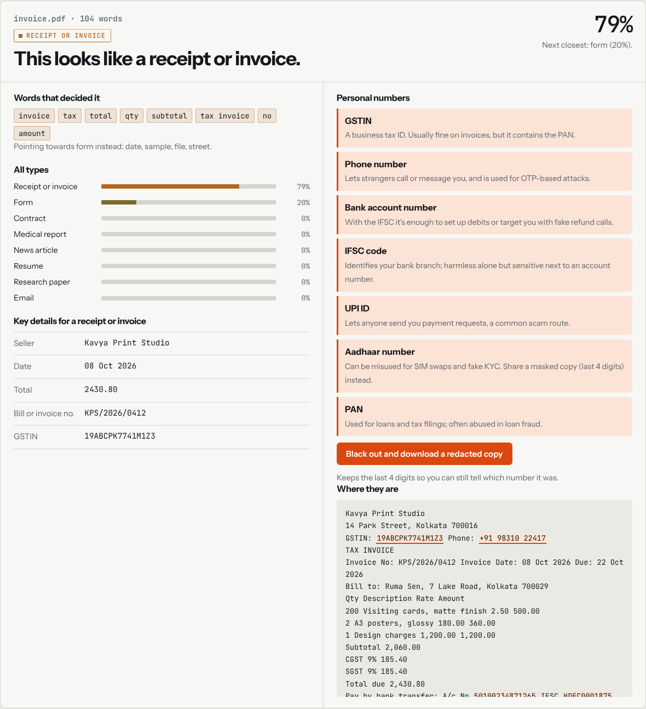
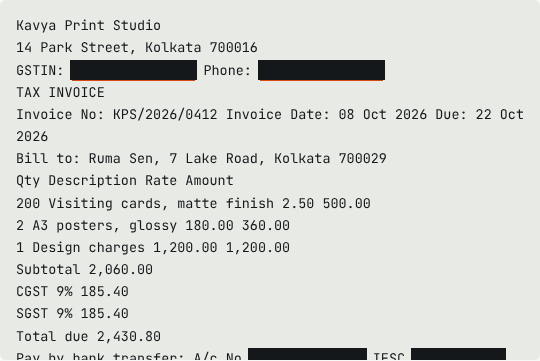
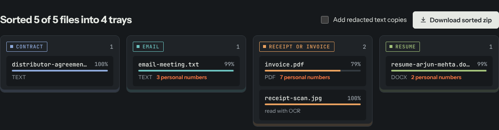
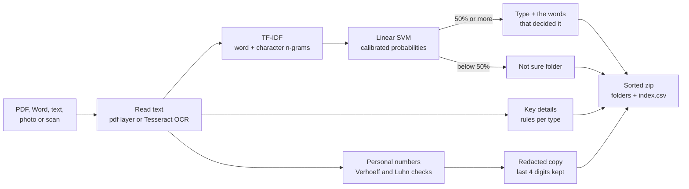

<picture>
  <source media="(prefers-color-scheme: dark)" srcset="docs/readme/banner-dark.svg">
  
</picture>

<p align="center">
  <a href="https://github.com/binayakmandal-hash/docusort-ai/actions/workflows/tests.yml"></a>
  
  
  
</p>

<p align="center">
  <a href="#what-it-does">Features</a> ·
  <a href="#how-it-works">How it works</a> ·
  <a href="#how-accurate-is-it">Accuracy</a> ·
  <a href="#run-it">Run it</a> ·
  <a href="DATASETS.md">Datasets</a>
</p>

Drop in a pile of PDFs, Word files, scans and phone photos. DocuSort says what kind of document each one is and why, pulls out the details you'd look for first, marks personal numbers before you share a file, and hands the pile back as a zip sorted into folders.

**Live demo:** [docusort-ai-34ft.onrender.com](https://docusort-ai-34ft.onrender.com) (free plan, sleeps when idle; the first request after a while takes about a minute)



| At a glance | |
|---|---|
| Document types | 8, plus a "Not sure" folder |
| Accuracy on sources it never saw | 83% |
| Personal-number kinds found | 11, with checksum validation where one exists |
| Files per batch | up to 50 |
| Data kept after you leave | none; batches expire from memory after 15 minutes |

## What it does

| | |
|---|---|
| **Sorts 8 document types** | Contract, email, form, medical report, news article, receipt or invoice, resume, research paper. Anything below 50% confidence goes in a "Not sure" folder instead of a wrong one. |
| **Reads anything** | PDF (with a text layer or scanned), Word `.docx`, plain text, and photos or scans through Tesseract OCR. |
| **Shows why** | The words that pushed the decision, and the ones that pulled towards the runner-up. For a linear model this is an exact breakdown of the score, not an approximation. |
| **Pulls out key details** | Receipts and invoices: seller, date, total, invoice number, GSTIN. Contracts: title, parties, date, governing law, term. Emails, resumes, papers, medical reports and forms get their own fields. |
| **Finds personal numbers** | Aadhaar (checked with the Verhoeff check digit), PAN, card numbers (Luhn check and real card-network prefixes), bank account and IFSC, phone, email, UPI ID, passport and voter ID. One click blacks them out and downloads a redacted copy that keeps the last 4 digits. |
| **Sorts a batch** | Up to 50 files at once. Download a zip with one folder per type, an `index.csv` listing each file's type, confidence, key details and personal-number count, and optional redacted copies. |

<table>
  <tr>
    <td width="60%"></td>
    <td width="40%"><br><sub>Redaction blacks out each number in place before the download.</sub><br><br><br><sub>Dark mode follows your system setting.</sub></td>
  </tr>
</table>

## How it works



The explanation is exact, not estimated. A linear model's score for a type is the sum of each word's TF-IDF weight times the model's weight for that word, so the words shown are the actual terms that added the most to the decision, and the ones that pulled hardest towards the runner-up.

Personal numbers with a built-in check digit are verified before they are flagged: Aadhaar with Verhoeff, cards with Luhn plus real card-network prefixes. Numbers without a checksum, like bank accounts and voter IDs, only count next to words such as "A/c" or "EPIC". On 4,307 training documents the finder flagged 0 Aadhaar or PAN numbers, which is the false-alarm check.

## How accurate is it?

Every number below is written by the training and evaluation scripts to [`reports/metrics.json`](reports/metrics.json), and the app's "How accurate is it?" page reads from the same file.

| Test | Result |
|---|---|
| Held-out test, 862 documents from the training sources | **99.8%** accuracy, macro F1 0.997 |
| Documents from sources it never saw (AG News, real invoices) | **83%** (news 89%, invoices 4 of 13) |
| Only the first 100 characters of each document | 92% |
| Simulated OCR errors (15% of characters damaged) | 99.6% |
| Receipt totals read exactly (526 receipts the rules were never tuned on) | 70% (dates 97%, shop name 77% exact, 95% allowing a shorter or longer form) |

**Read the first number with care.** Each type was learned mostly from one public dataset, so the model can partly learn "which dataset is this from" instead of "what kind of document is this". The second number, from new sources, is the honest one. It also shows the weak spot: real business invoices look like forms to the model, because the training data has shop receipts but no invoices.

**A mistake that changed the data.** The first model learned research papers only from computer-science papers, then called 268 of 300 medical research abstracts "medical reports". It had learned the topic, not the document type. Medical abstracts were added to the training data, and the experiment is repeated on every training run (`leave_one_source_out` in the metrics).

**Model choice.** Linear SVM, logistic regression and Complement Naive Bayes were compared with 5-fold cross-validation on the training split. The linear SVM on word and character n-grams won (macro F1 0.999) and is calibrated so the app can show a probability and say "not sure".

**Known limits.** It only knows these 8 types, so an unrelated document still gets one of them, often with high confidence. English only. OCR quality limits photos and scans. Details for types other than receipts have no answer key to test against.

## Run it

```bash
git clone https://github.com/binayakmandal-hash/docusort-ai.git
cd docusort-ai
python -m venv .venv && source .venv/bin/activate   # Windows: .venv\Scripts\activate
pip install -r requirements.txt
python app.py                                        # http://127.0.0.1:5000
```

Reading photos and scans also needs the [Tesseract](https://github.com/tesseract-ocr/tesseract) program. Everything else works without it. The trained model is included, so no training is needed to run the app.

Tests: `python -m unittest discover -s tests`

To rebuild the dataset and retrain from scratch, see [DATASETS.md](DATASETS.md).

## Deploy

The repo includes a `Dockerfile` (with Tesseract) and a Render blueprint. In Render: **New → Blueprint → pick this repo**. The free plan sleeps when idle, so the first request after a while takes about a minute.

## Project structure

```
app.py                  Flask app: pages, sorting API, batch zip, redaction
src/reader.py           Text from PDF, Word, text and images (OCR)
src/classifier.py       Loads the model, classifies, explains the decision
src/fields.py           Key details for each document type
src/sensitive.py        Personal-number finder and redaction
src/build_dataset.py    Builds the training set from the public datasets
src/train.py            Compares models, evaluates, saves the final model
src/evaluate_fields.py  Receipt details against the SROIE answer key
src/evaluate_sensitive.py  False-alarm check for the personal-number finder
models/                 Trained model (16 MB)
reports/metrics.json    Every measured number
samples/                Sample documents for the demo
templates/, static/     Interface (HTML, CSS, vanilla JavaScript)
tests/                  Unit and API tests
```

## Privacy

Uploaded files are read in memory and not saved. A sorted batch is kept in memory for 15 minutes so the zip can be downloaded. No accounts, cookies, analytics or third-party AI services. Details are on the app's privacy page.

## License

Code: [MIT](LICENSE) © 2026 Binayak Mandal. Training data keeps its own licences, see [DATASETS.md](DATASETS.md).
